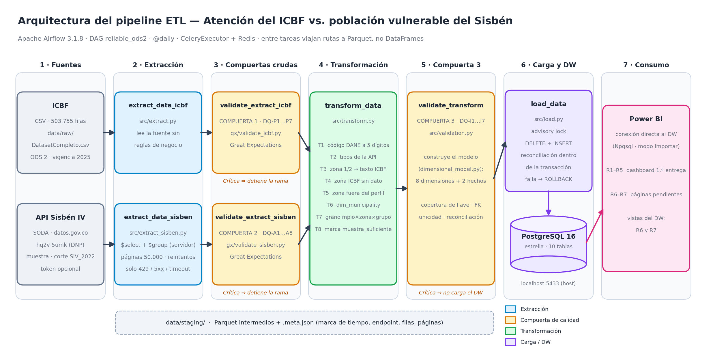
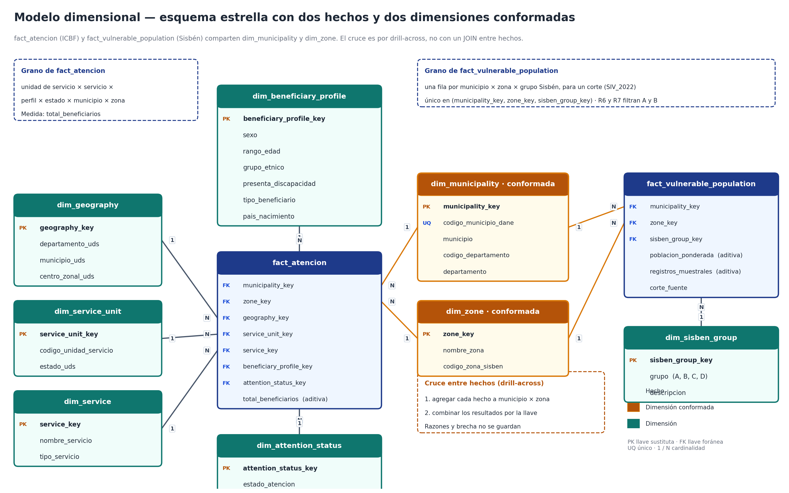

# Atención del ICBF a la primera infancia frente a la población vulnerable del Sisbén (ODS 2 — Hambre Cero)

**Curso:** ETL (G01) — Ingeniería de Datos e Inteligencia Artificial
**Fase 1:** De los requerimientos analíticos a un Data Warehouse dimensional (ICBF)
**Fase 2:** Integración de una segunda fuente (API Sisbén), orquestación con Airflow y carga a PostgreSQL
**ODS seleccionado:** ODS 2 — Hambre Cero

---

## Tabla de contenido

1. [Problema colombiano](#1-problema-colombiano)
2. [Objetivo analítico y requerimientos (R1–R7)](#2-objetivo-analítico-y-requerimientos-r1r7)
3. [Alineación con el ODS](#3-alineación-con-el-ods)
4. [Fuentes de datos](#4-fuentes-de-datos)
5. [Valor analítico de la API del Sisbén](#5-valor-analítico-de-la-api-del-sisbén)
6. [Perfilamiento y reglas de calidad](#6-perfilamiento-y-reglas-de-calidad)
7. [Trazabilidad requerimientos → datos](#7-trazabilidad-requerimientos--datos)
8. [Estrategia de integración](#8-estrategia-de-integración)
9. [Transformaciones (T1–T9)](#9-transformaciones-t1t9)
10. [Arquitectura del sistema y orquestación](#10-arquitectura-del-sistema-y-orquestación)
11. [Modelo dimensional](#11-modelo-dimensional)
12. [Trazabilidad requerimientos → modelo](#12-trazabilidad-requerimientos--modelo)
13. [Pipeline ETL y compuertas de calidad](#13-pipeline-etl-y-compuertas-de-calidad)
14. [Data Warehouse (PostgreSQL)](#14-data-warehouse-postgresql)
15. [Consultas analíticas y KPIs](#15-consultas-analíticas-y-kpis)
16. [Business Intelligence](#16-business-intelligence)
17. [Interpretación analítica — hallazgos](#17-interpretación-analítica--hallazgos)
18. [Supuestos y limitaciones](#18-supuestos-y-limitaciones)
19. [Cómo reproducir el proyecto](#19-cómo-reproducir-el-proyecto)
20. [Estructura del repositorio](#20-estructura-del-repositorio)
21. [Registro de cambios (primera → segunda entrega)](#21-registro-de-cambios-primera--segunda-entrega)
22. [Pruebas de confiabilidad y evidencia](#22-pruebas-de-confiabilidad-y-evidencia)
23. [Equipo y responsabilidades](#23-equipo-y-responsabilidades)

---

## 1. Problema colombiano

Colombia presenta una alta heterogeneidad territorial en la distribución de la población y de
los servicios dirigidos a la primera infancia. El gran volumen de beneficiarios y su dispersión
entre departamentos, municipios y unidades de servicio dificulta identificar patrones
territoriales y características de la población infantil atendida por el Instituto Colombiano de
Bienestar Familiar (ICBF). Además, el conjunto del ICBF describe solo a quienes **ya reciben**
atención: no dice nada sobre la población que podría necesitarla. Sin ese contexto, un volumen alto
de beneficiarios puede reflejar una atención amplia o simplemente una población vulnerable muy
grande, y no se puede saber si algún territorio o zona quedó rezagado.

| Elemento | Descripción |
|---|---|
| **ODS** | ODS 2 — Hambre Cero |
| **Metas relacionadas** | Meta 2.1 (acceso a alimentación sana, nutritiva y suficiente, con énfasis en población vulnerable) y Meta 2.2 (fin a todas las formas de malnutrición infantil) |
| **Contexto colombiano** | El ICBF es la entidad rectora de la protección integral de la primera infancia. Varias de sus modalidades (HCB, HCB FAMI, MAI) incluyen componentes de alimentación y complemento nutricional |
| **Alcance geográfico** | Nacional — 32 departamentos + Bogotá D.C. |
| **Población / fenómeno de interés** | Beneficiarios de primera infancia atendidos por el ICBF, contrastados con la población vulnerable registrada en el Sisbén (grupos A y B) |
| **Interesados** | ICBF (planificación y focalización), Ministerio de Salud y Protección Social, gobernaciones y alcaldías, organismos de cooperación y ONG de primera infancia, investigadores en política social |
| **Relevancia para la decisión** | Permite priorizar territorios y perfiles poblacionales, y detectar dónde la atención es baja o alta en relación con la población vulnerable |

## 2. Objetivo analítico y requerimientos (R1–R7)

**Objetivo analítico:** analizar la distribución territorial y las características de la población
infantil atendida por el ICBF, y contrastar esa atención con la población vulnerable registrada en
el Sisbén, para identificar patrones de concentración, diferencias territoriales y posibles brechas
que aporten a la planificación de acciones de primera infancia y del ODS 2.

| ID | Requerimiento analítico | Pregunta de negocio | Fuente |
|---|---|---|---|
| **R1** | Distribución territorial de beneficiarios entre departamentos | ¿Qué departamentos concentran más beneficiarios? | ICBF |
| **R2** | Municipios con mayor concentración dentro de cada departamento | ¿Qué municipios requieren mayor atención dentro de un departamento? | ICBF |
| **R3** | Tipos de servicio con más beneficiarios y su variación por departamento | ¿Qué modalidades tienen mayor cobertura y dónde? | ICBF |
| **R4** | Caracterización demográfica (sexo, edad, etnia, discapacidad) | ¿Qué perfiles predominan entre los atendidos? | ICBF |
| **R5** | Cruce territorio × vulnerabilidad (etnia, discapacidad, zona rural) | ¿Dónde coinciden varios factores de vulnerabilidad? | ICBF |
| **R6** | Municipios con mayor y menor atención del ICBF en relación con su población vulnerable (Sisbén A y B) | ¿Qué municipios están más y menos atendidos respecto a su población vulnerable? | ICBF + API Sisbén |
| **R7** | Si la distribución urbano-rural de la atención es proporcional a la de la población vulnerable | ¿Está la atención sesgada hacia la zona urbana o la rural frente a la necesidad? | ICBF + API Sisbén |

### 2.1 Línea base de la primera entrega y estado de R1–R5

- **Repositorio de la primera entrega (se conserva intacto):** _[pegar aquí la URL del repositorio de la 1.ª entrega]_
- **Línea base:** Data Warehouse dimensional en MySQL con una tabla de hechos (`fact_atencion`), cinco
  dimensiones y un dashboard en Power BI ([`docs/Dashboard.pbix`](docs/Dashboard.pbix)) para R1–R5,
  construido solo con el dataset del ICBF.
- **Modelo dimensional previo:** ver la sección 21 (registro de cambios) y la figura de la sección 11.

| Req. | Estado | Cambio introducido | Justificación | Salida analítica en la 2.ª entrega |
|---|---|---|---|---|
| R1 | **Mantiene** | Ninguno | Sigue siendo válido y no depende de la nueva fuente | Distribución de beneficiarios por departamento y % de participación |
| R2 | **Mantiene** | Ninguno | Sigue siendo válido | Top 5 de municipios dentro de cada departamento |
| R3 | **Mantiene** | Ninguno | Sigue siendo válido | Tipos de servicio con más beneficiarios y su variación por departamento |
| R4 | **Mantiene** | Solo se retiró `zona_ubicacion` de `dim_beneficiary_profile`, atributo que R4 no usa | La zona pasó a ser un eje conformado compartido por ambos hechos | Caracterización por sexo, rango de edad, grupo étnico y discapacidad |
| R5 | **Refina** | La zona rural ya no sale del perfil del beneficiario sino de `dim_zone` por `zone_key` | Requerido por el nuevo requerimiento R7, que necesita la zona como dimensión conformada | Concentración de etnia, discapacidad y zona rural por departamento. El resultado debe ser el mismo |

Ningún requisito de R1–R5 fue eliminado ni reemplazado.

## 3. Alineación con el ODS

**ODS 2 — Hambre Cero, metas 2.1 y 2.2.** El proyecto **no reproduce un indicador oficial** del
ODS 2: ninguna de las dos fuentes mide hambre, inseguridad alimentaria o desnutrición. La relación
es indirecta:

- Varias modalidades del ICBF (HCB, HCB FAMI, MAI-La Guajira) incluyen componentes de
  alimentación, por lo que la cobertura y distribución de la atención funciona como un **proxy
  indirecto** del acceso a mecanismos de seguridad alimentaria en primera infancia.
- El perfilamiento muestra que **La Guajira concentra el 15,95 %** de los beneficiarios, muy por
  encima del segundo departamento (Antioquia, 7,91 %).
- **R1–R5** muestran dónde y a quién llega la atención. **R6–R7** agregan el contexto de necesidad
  (población A+B del Sisbén) para evaluar si esa atención es proporcional.

**Limitación reconocida:** los hallazgos son evidencia de **cobertura y distribución de la atención
institucional**, no una medición directa del estado nutricional.

## 4. Fuentes de datos

### 4.1 ICBF — Caracterización de Beneficiarios de las Modalidades de Primera Infancia

| Campo | Valor |
|---|---|
| **Institución** | Instituto Colombiano de Bienestar Familiar (ICBF) |
| **Acceso** | https://www.datos.gov.co/Inclusi-n-Social-y-Reconciliaci-n/Caracterizaci-n-de-Beneficiarios-de-las-Modalidade/5akr-u7t8/about_data |
| **Formato** | CSV / Excel (el DAG lee `data/raw/DatasetCompleto.csv`) |
| **Registros** | 503.755 filas, 21 columnas originales |
| **Total de beneficiarios** | 2.019.403 |
| **Cobertura temporal** | Corte de extracción 28 de agosto de 2026; `Vigencia` solo contiene 2025 |
| **Medida** | `Beneficiarios` (conteo agregado por combinación de atributos) |

**Adquisición (el archivo no se versiona por su tamaño):**

1. Descargar el dataset desde la URL anterior en formato CSV.
2. Guardarlo como `data/raw/DatasetCompleto.csv`, respetando exactamente ese nombre y ruta.

### 4.2 Sisbén IV — API "Sisbén Personas" (DNP)

| Ítem | Documentación |
|---|---|
| **Proveedor y propósito** | Departamento Nacional de Planeación (DNP), publicado en datos.gov.co. Muestra anonimizada y probabilística de la base del Sisbén IV (marzo de 2022) con clasificación socioeconómica, zona y factor de expansión |
| **Endpoint** | `https://www.datos.gov.co/resource/hq2v-5umk.json` (SODA, método GET) |
| **Consulta** | `$select=cod_mpio, zona, grupo, corte, sum(fex) as sum_fex, count(*) as count` · `$where=grupo in ('A','B')` · `$group=cod_mpio, zona, grupo, corte` · `$order=cod_mpio, zona, grupo` · paginación con `$limit` y `$offset` |
| **Respuesta** | JSON, arreglo de objetos. Los valores llegan como texto y se convierten en la transformación. La agregación la hace el servidor: no se descargan filas de personas |
| **Autenticación** | Token de aplicación **opcional**, enviado en el encabezado `X-App-Token` y leído de `SOCRATA_APP_TOKEN` en `.env`. Sin token los límites de tasa son más bajos |
| **Comportamiento operativo** | Páginas de 50.000 filas; tiempo de espera (conexión 10 s, lectura 120 s). Reintentos con espera exponencial (2, 4, 8 s) solo para fallas transitorias: timeouts, errores de conexión, 429 y 5xx. Los 400, 401, 403 y 404 son deterministas y **no** se reintentan: detienen la rama |
| **Reproducibilidad** | Cualquier evaluador ejecuta el mismo GET, con o sin token. La respuesta cruda se guarda en `data/staging/raw_sisben_agregado.parquet` junto con un archivo `.meta.json` (marca de tiempo, endpoint, consulta, número de filas y páginas, uso de token). El corte es fijo (`SIV_2022`), así que el resultado es repetible |
| **Última extracción registrada** | 4.393 filas, 1 página, sin token |

## 5. Valor analítico de la API del Sisbén

El conjunto del ICBF describe cuántas personas se atienden, dónde están y qué servicio usan. La API
aporta el contrapeso: una muestra probabilística de personas registradas en el Sisbén IV, con su
clasificación (`grupo`), su `zona` y un factor de expansión (`fex`) que estima la población que
representa cada registro. Con los grupos A y B se obtiene una aproximación de la población en
pobreza extrema y moderada.

- **R6** necesita ese denominador para convertir el conteo de beneficiarios en una medida relativa
  de atención por municipio.
- **R7** necesita la distribución urbano-rural de la población vulnerable para compararla con la
  distribución urbano-rural de la atención.

Por las limitaciones de la sección 18 (corte 2022 vs. ICBF 2025, sin edad, solo población
registrada), las medidas se presentan como **indicadores relativos para comparar territorios**, no
como tasas de cobertura.

## 6. Perfilamiento y reglas de calidad

El perfilamiento del ICBF está en [`notebooks/profile.py`](notebooks/profile.py) y el del Sisbén en
[`notebooks/profiling_sisben.ipynb`](notebooks/profiling_sisben.ipynb). Las reglas se implementan con
Great Expectations en [`gx/validate_icbf.py`](gx/validate_icbf.py) y
[`gx/validate_sisben.py`](gx/validate_sisben.py), y con reglas propias en `src/validation.py`.

**Política de severidad**

| Severidad | Efecto |
|---|---|
| **Crítica** | Detiene la rama y no avanza a la siguiente compuerta |
| **Advertencia** | La ejecución continúa, con la política documentada y la evidencia registrada |
| **Informativa** | Solo se monitorea |

### 6.1 Reglas del ICBF (perfilamiento inicial)

| Atributo(s) | Regla | Umbral | Severidad |
|---|---|---|---|
| Códigos de departamento, municipio, centro zonal y unidad de servicio | Sin nulos (completitud) | ≥ 100 % | Crítica |
| Esos mismos códigos | Sin valores negativos (validez) | 100 % | Crítica |
| `Beneficiarios` | Sin nulos | ≥ 100 % | Advertencia |
| `Beneficiarios` | Sin valores negativos | 100 % | Crítica |
| `Sexo` | Solo `{M, H, I}` | 100 % | Crítica |
| `Estado Atención` | Solo `{1, 2, A, I}` (luego se normaliza a `{A, I}`) | ≥ 95 % | Crítica |
| `Zona Ubicacion Beneficiario` | Solo `{CABECERA, RESTO}` | ≥ 98 % | Crítica |
| `Presenta Discapacidad` | Solo `{SI, NO}` | ≥ 98 % | Advertencia |
| Centro zonal, municipio, departamento, grupo étnico, rango de edad, nombre y tipo de servicio, tipo de beneficiario | Sin nulos | ≥ 100 % | Crítica |
| `Estado UDS` | Solo `{ACTIVA, INACTIVA}` | ≥ 98 % | Advertencia |

### 6.2 Reglas de la API del Sisbén (DQ-A)

| ID | Regla | Umbral y base | Severidad |
|---|---|---|---|
| **DQ-A1** Completitud | La respuesta trae los seis campos esperados (`cod_mpio`, `zona`, `grupo`, `corte`, `sum_fex`, `count`) y ninguno es nulo | 0 ausentes y 0 nulos; la consulta define esos campos | Crítica |
| **DQ-A2** Código de municipio | `cod_mpio` es una cadena numérica de exactamente 5 caracteres | 0 violaciones; formato DANE, llave de integración | Crítica |
| **DQ-A3** Dominios | `grupo ∈ {A, B}` y `zona ∈ {1, 2}` | 0 violaciones; la consulta filtra A y B y el mapeo urbano/rural supone dominio binario | Crítica |
| **DQ-A4** Pesos y conteos | `sum_fex > 0` y `count ≥ 1` | 0 violaciones; un factor de expansión es positivo por definición | Crítica |
| **DQ-A5** Unicidad del grano | `(cod_mpio, zona, grupo)` es único | 0 duplicados; una llave repetida duplicaría la población estimada | Crítica |
| **DQ-A6** Consistencia del corte | Un único valor distinto de `corte` y es `SIV_2022` | Exactamente 1 valor; mezclar cortes distorsiona la ponderación | Crítica |
| **DQ-A7** Cobertura de municipios | El número de municipios distintos coincide con la referencia del perfilamiento | 1.099; una diferencia indica que la fuente cambió | Advertencia |
| **DQ-A8** Fiabilidad estadística | Cada par municipio–zona tiene al menos 30 registros muestrales para publicar su razón | Mínimo 30. Es una convención estadística de muestra mínima para estimaciones estables, no sale de los datos. En la extracción actual afecta a tres pares: 08758 zona 2, 13760 zona 2 y 97001 zona 2 | Advertencia |

### 6.3 Reglas de integración y datos preparados (DQ-I)

| ID | Regla | Umbral | Severidad |
|---|---|---|---|
| **DQ-I1** Cobertura de la llave | % de beneficiarios cuyo municipio existe en la API. No se exige 100 % porque hay códigos que cambian por reorganización administrativa. Referencia actual: **99,56 %** | < 95 % Crítica; 95–100 % Advertencia | Crítica / Advertencia |
| **DQ-I2** Zona sin información | % de beneficiarios en `SIN INFORMACIÓN` (R7 los excluye) | > 1 % Advertencia | Advertencia |
| **DQ-I3** Integridad referencial | Toda llave foránea de ambos hechos existe en su dimensión | 0 huérfanas | Crítica |
| **DQ-I4** Unicidad del grano | `fact_atencion` único en su combinación de llaves; `fact_vulnerable_population` único en `(municipality_key, zone_key, sisben_group_key)` | 0 duplicados | Crítica |
| **DQ-I5** Reconciliación | `SUM(total_beneficiarios)` igual al de la fuente depurada; `SUM(poblacion_ponderada)` igual a la suma de `sum_fex` de la API cruda; mismo conteo de filas del hecho de población | Diferencia 0 (descontando filas rechazadas documentadas) | Crítica |
| **DQ-I6** Dominio de dimensiones nuevas | `dim_zone` tiene exactamente CABECERA, RESTO y SIN INFORMACIÓN; `dim_sisben_group` tiene A y B; `dim_municipality` tiene códigos únicos de 5 caracteres | 0 violaciones | Crítica |
| **DQ-I7** Plausibilidad de la razón | Distribución de beneficiarios por 1.000 personas ponderadas, con extremos listados | Sin umbral (no hay base para fijar un máximo) | Informativa |

### 6.4 Compuerta 1: ICBF crudo (DQ-P)

| ID | Regla | Severidad |
|---|---|---|
| **DQ-P1** | La tabla trae todas las columnas que consume el modelo dimensional (0 ausentes) | Crítica |
| **DQ-P2** | `Codigo Municipio UDS` no es nulo, es numérico y, rellenado a 5 caracteres, su prefijo coincide con `Codigo Departamento UDS` | Crítica |
| **DQ-P3** | `Total Beneficiarios` no es nulo, es entero y no es negativo | Crítica |
| **DQ-P4** | `Zona Ubicacion` pertenece a `{CABECERA, RESTO, SIN INFORMACIÓN}` | Crítica |
| **DQ-P5** | `Sexo`, `Rango Edad`, `Grupo Etnico` y `Presenta Discapacidad` pertenecen a su catálogo. El valor desconocido se conserva como categoría explícita y se reporta. **Pendiente:** corregir el conjunto válido de `Rango Edad`, que hoy está en mayúsculas en `src/validation.py` | Advertencia |
| **DQ-P6** | `Departamento UDS` y `Municipio UDS` no son nulos | Advertencia |
| **DQ-P7** | La combinación de atributos dimensionales no se repite (0 duplicados exactos). Sujeta a confirmar que la fuente venga agregada a ese grano | Advertencia |

## 7. Trazabilidad requerimientos → datos

| Atributo | Fuente | Requerimiento | Uso posterior |
|---|---|---|---|
| Código de municipio (`Codigo Municipio UDS`) | ICBF | R2, R6 | Se rellena con ceros a 5 caracteres; es la llave de unión con la API. Queda en la dimensión conformada de municipio |
| Municipio y departamento (UDS) | ICBF | R1, R2, R6, R7 | Etiquetas y agregación territorial |
| `total_beneficiarios` | ICBF | R1 a R7 | Numerador de R6 y base del porcentaje de R7 |
| Zona del beneficiario | ICBF | R5, R7 | Se cruza con la zona del Sisbén. Los `SIN INFORMACIÓN` se excluyen de R7 y se reportan aparte |
| `cod_mpio` | API | R6, R7 | Llave de unión por municipio; se agrega a departamento para R7 |
| `grupo` | API | R6, R7 | Filtro A y B; define la población vulnerable |
| `fex` | API | R6, R7 | Ponderador: la suma da la población A+B (denominador de R6 y base del % rural de R7) |
| `zona` | API | R7 | Se mapea a CABECERA / RESTO. **Mapeo inferido, a confirmar con el DNP** |
| `corte` | API | Calidad | Se valida como único (`SIV_2022`) y se registra como linaje de la fuente |
| `llave`, `hogar`, `orden` | API | Calidad | Solo para la regla de llaves duplicadas; no se cargan al DW |
| Población A+B ponderada | Derivada (API) | R6, R7 | Medida de `fact_vulnerable_population` (grano municipio × zona × grupo) |
| Razón por 1.000 y brecha en puntos porcentuales | Derivada | R6, R7 | KPI calculado en vista o en el dashboard; no se guarda |

## 8. Estrategia de integración

1. **Llave de integración:** `codigo_municipio_dane`, de 5 caracteres. En el ICBF se deriva de
   `Codigo Municipio UDS` rellenado con ceros a la izquierda; en la API es `cod_mpio`. La llave de
   zona es `codigo_zona_sisben` (1 = CABECERA, 2 = RESTO).
2. **Dónde se integra:** no hay un `pd.merge` entre fuentes. Cada fuente se carga a su tabla de
   hechos con la llave sustituta de `dim_municipality` y `dim_zone`. La integración ocurre en esas dos
   **dimensiones conformadas**.
3. **Cardinalidad:** cada fuente contra la dimensión es muchos a uno. La API agregada tiene como
   máximo 4 filas por municipio (grupos A y B × zonas 1 y 2); la extracción actual tiene 4.393.
4. **Alineación temporal:** el Sisbén es un corte único (`SIV_2022`, marzo de 2022) y el ICBF refleja
   beneficiarios atendidos en 2025. No hay ventana de empate exacta: el Sisbén se usa como **línea
   base estructural** de la población vulnerable, no como foto simultánea.
5. **Registros sin cruce:** el ICBF tiene 1.114 municipios y 1.099 cruzan, lo que equivale al
   **99,56 %** de los beneficiarios. Los 15 códigos restantes se cargan igual en `dim_municipality`
   y quedan sin población; sus razones de R6 se excluyen, pero cuentan en los totales de R1–R5.
6. **Coincidencias ambiguas:** `codigo_municipio_dane` es único en `dim_municipality` y la regla
   DQ-A5 cubre la unicidad del lado de la API. Una repetición detiene la rama (Crítica).
7. **Cruce entre hechos:** se hace con *drill-across*, no con un JOIN directo. Cada hecho se agrega
   por separado a municipio × zona y luego se combinan; unirlos directamente multiplicaría la población
   por cada fila del ICBF.

## 9. Transformaciones (T1–T9)

| ID | Transformación | Regla y manejo de excepciones | Impacto |
|---|---|---|---|
| **T1** | Normalizar el código de municipio del ICBF | `5001` → `"05001"`. Si no queda de 5 dígitos, la fila se marca y la compuerta de datos preparados la reporta; no se corrige a mano | Habilita la llave de `dim_municipality` y el cruce |
| **T2** | Convertir tipos de la API | `sum_fex` → decimal(16,4), `count` → entero, `zona` → entero pequeño. Un valor no convertible detiene la rama (violación de DQ-A4) | `poblacion_ponderada`, `registros_muestrales` |
| **T3** | Mapear la zona del Sisbén al vocabulario del ICBF | 1 → CABECERA, 2 → RESTO. Cualquier otro valor viola DQ-A3 y detiene la rama. **Pendiente:** confirmar con un tercer municipio rural (Vaupés 97001 o Cumaribo 99773) | `dim_zone`, base de R7 |
| **T4** | Zona del ICBF sin dato | Nulo o vacío → registro `SIN INFORMACIÓN` de `dim_zone`; no se imputa. Si supera el 1 % de beneficiarios, Advertencia | Cuentan en R1–R5; R7 los excluye |
| **T5** | Mover la zona fuera del perfil del beneficiario | Se retira `zona_ubicacion` de `dim_beneficiary_profile`; `fact_atencion` gana `zone_key` | R5 toma la zona rural de `dim_zone` |
| **T6** | Construir `dim_municipality` | Una fila por código DANE con nombre y departamento del ICBF. Un código que existe solo en la API se carga con nombre `SIN NOMBRE` y se reporta; no se inventa | `municipality_key` para ambos hechos |
| **T7** | Cargar la población al grano del modelo | Grano municipio × zona × grupo. `sum_fex` → `poblacion_ponderada`, `count` → `registros_muestrales`, `corte` → `corte_fuente`. Una combinación repetida detiene la carga | `fact_vulnerable_population` aditiva |
| **T8** | Marcar, no eliminar, los pares con pocos registros | Pares con menos de 30 registros se cargan completos y se marcan con la bandera `muestra_suficiente`; la vista de R6/R7 la usa para filtrar al calcular la razón | No se pierden filas |
| **T9** | Asignar llaves sustituta y cargar `fact_atencion` | Cada dimensión asigna su llave. Una llave foránea sin dimensión detiene la carga (Crítica) | `SUM(total_beneficiarios)` reconcilia con la fuente |

**Reglas generales del transform**

- El código de municipio **no** se rellena con ceros en la rama de la API: DQ-A2 exige que llegue con
  5 caracteres. Corregirlo en la transformación haría pasar la validación artificialmente.
- Una zona desconocida lanza error, coherente con DQ-A3.
- `muestra_suficiente` es una bandera, no un filtro (T8).
- La columna `corte` debe existir; si falta, la función falla con un error claro.

Del lado del ICBF se mantienen las decisiones de la primera entrega: tipado de identificadores,
estandarización categórica (mayúsculas, sin espacios extra), normalización de `Estado Atención`
(`1`→`A`, `2`→`I`), nulos puntuales como `SIN INFORMACIÓN`, `Modalidad` excluida (~64 % de nulos) y
`Tipo Servicio` derivado de `Nombre Servicio`.

## 10. Arquitectura del sistema y orquestación

```
 ICBF (CSV)                              API Sisbén (SODA, datos.gov.co)
     │                                              │
     ▼                                              ▼
extract_data_icbf                          extract_data_sisben
     │                                              │
     ▼                                              ▼
validate_data_extract_icbf (GX)          validate_data_extract_sisben (GX)
   Compuerta 1 · DQ-P                       Compuerta 2 · DQ-A
     └───────────────────┬──────────────────────────┘
                         ▼
                  transform_data                (T1–T8)
                         │
                         ▼
             validate_data_transform            Compuerta 3 · DQ-I
              (construye el modelo y valida)
                         │
                         ▼
                     load_data  ──►  PostgreSQL (esquema estrella, 2 hechos)
                                           │
                                           ▼
                                  Power BI / consultas SQL
```

El DAG [`dags/reliable_ods2.py`](dags/reliable_ods2.py) (`dag_id="reliable_ods2"`, `@daily`,
`catchup=False`) corre sobre **Apache Airflow 3.1.8** con `CeleryExecutor`, Redis y PostgreSQL,
levantado con [`docker-compose.yaml`](docker-compose.yaml). Entre tareas viajan **rutas** a archivos
Parquet en `data/staging/`, no DataFrames.



## 11. Modelo dimensional



Dos tablas de hechos que comparten dos dimensiones conformadas (`dim_municipality` y `dim_zone`).
DDL completo en [`sql/create_dw.sql`](sql/create_dw.sql).

| Tabla | Tipo | Contenido |
|---|---|---|
| `dim_geography` | Dimensión | Departamento → municipio → centro zonal (jerarquía del ICBF) |
| `dim_service_unit` | Dimensión | Unidad de servicio y su estado (ACTIVA / INACTIVA) |
| `dim_service` | Dimensión | `nombre_servicio` y `tipo_servicio` derivado |
| `dim_beneficiary_profile` | Dimensión *junk* | Sexo, rango de edad, grupo étnico, discapacidad, tipo de beneficiario, país de nacimiento (**ya sin zona**) |
| `dim_attention_status` | Dimensión | Estado de atención (A/I) |
| `dim_municipality` | **Conformada** | `codigo_municipio_dane` CHAR(5) único, municipio, departamento. Une ambas fuentes |
| `dim_zone` | **Conformada** | CABECERA, RESTO y SIN INFORMACIÓN; `codigo_zona_sisben` (1, 2, NULL) |
| `dim_sisben_group` | Dimensión | Grupos A, B, C y D con su descripción (R6 y R7 filtran A y B) |
| `fact_atencion` | Hecho | Medida `total_beneficiarios` (aditiva) |
| `fact_vulnerable_population` | Hecho | Medidas `poblacion_ponderada` y `registros_muestrales` (aditivas) y `corte_fuente` |

**Declaraciones de grano**

- `fact_atencion`: una fila por combinación de unidad de servicio, servicio, perfil de beneficiario,
  estado de atención, municipio y zona (más geografía). Restricción única sobre las siete llaves.
- `fact_vulnerable_population`: una fila por municipio × zona × grupo Sisbén, para un corte dado.
  Restricción única sobre `(municipality_key, zone_key, sisben_group_key)`.
- **La cobertura y la brecha no se guardan:** son razones y no se pueden sumar. Se calculan en vistas
  o en el dashboard.

No se creó dimensión de tiempo: `Vigencia` tiene un único valor (2025) y el corte del Sisbén es único
(2022), por lo que no hay jerarquía temporal real.

## 12. Trazabilidad requerimientos → modelo

| Req. | Hechos | Dimensiones | KPI | Cambio vs. 1.ª entrega |
|---|---|---|---|---|
| R1 | `fact_atencion` | `dim_geography` (departamento) | Total y % de participación (el % es razón: se calcula en consulta o DAX) | Ninguno |
| R2 | `fact_atencion` | `dim_geography` (departamento y municipio) | Top 5 municipios por departamento | Ninguno |
| R3 | `fact_atencion` | `dim_service`, `dim_geography` | Distribución por tipo de servicio y departamento | Ninguno |
| R4 | `fact_atencion` | `dim_beneficiary_profile` | Distribución por sexo, edad, etnia, discapacidad | Solo se retiró `zona_ubicacion`, que R4 no usa |
| R5 | `fact_atencion` | `dim_geography`, `dim_beneficiary_profile` (etnia, discapacidad), `dim_zone` (zona rural) | % indígena / con discapacidad / rural por departamento | **Cambia la ruta de la zona rural:** ahora sale de `dim_zone` por `zone_key`. El resultado debe ser el mismo |
| R6 | `fact_atencion` + `fact_vulnerable_population` | `dim_municipality`; `dim_sisben_group` filtrado a A y B | Beneficiarios por cada 1.000 personas A+B ponderadas y ranking | Nuevo. Drill-across por `municipality_key`; umbral de 30 registros (DQ-A8) |
| R7 | `fact_atencion` + `fact_vulnerable_population` | `dim_zone`, `dim_municipality` (hasta departamento); `dim_sisben_group` filtrado a A y B | Brecha en puntos porcentuales = % de beneficiarios en zona rural − % de personas A+B en zona rural | Nuevo. Los `SIN INFORMACIÓN` se excluyen y se reportan aparte |

### 12.1 Matriz de trazabilidad extremo a extremo (filas representativas)

Cadena: requerimiento → dato → fuente → riesgo → regla → expectativa GX → transformación/integración →
elemento del DW → KPI o visualización.

| Req. | Dato requerido | Fuente | Riesgo de calidad | Regla DQ | Expectativa GX (tipo) | Transformación / integración | Elemento del DW | KPI o visualización |
|---|---|---|---|---|---|---|---|---|
| R6, R7 | `cod_mpio` | API Sisbén | Código con menos de 5 caracteres: la llave no cruza | DQ-A2 (Crítica) | Coincidencia con expresión regular de 5 dígitos | Integración por `codigo_municipio_dane` (sin corregir en el transform) | `dim_municipality` | Ranking de R6 |
| R6, R7 | `(cod_mpio, zona, grupo)` | API Sisbén | Fila repetida duplica la población estimada | DQ-A5 (Crítica) | Unicidad compuesta de las tres columnas | T7: carga al grano municipio × zona × grupo | `fact_vulnerable_population` | Denominador de R6 y base del % rural de R7 |
| R6 | `count` por municipio y zona | API Sisbén | Muestra pequeña vuelve inestable la razón | DQ-A8 (Advertencia) | Mínimo de registros por par municipio–zona | T8: bandera `muestra_suficiente` (no se eliminan filas) | `vw_r6_atencion_vs_vulnerabilidad` | Indicador de fiabilidad en el ranking de R6 |
| R7 | `zona` | API Sisbén | Valor fuera de {1, 2} rompe el mapeo urbano/rural | DQ-A3 (Crítica) | Valor dentro de un conjunto | T3: 1 → CABECERA, 2 → RESTO | `dim_zone` | Brecha urbano-rural de R7 |
| R6, R7 | `Codigo Municipio UDS` | ICBF | Código sin relleno no coincide con el DANE | DQ-P2 (Crítica) y DQ-I1 | Código numérico y consistente con el departamento (DQ-P2) | T1: relleno a 5 caracteres | `dim_municipality` | Cobertura de la llave (99,56 %) |
| R1–R7 | `total_beneficiarios`, `poblacion_ponderada` | Ambas | La carga pierde o duplica filas | DQ-I5 (Crítica) | Reconciliación de sumas y conteos | T9: llaves sustitutas y carga al grano | `fact_atencion`, `fact_vulnerable_population` | Todos los KPI del dashboard |

> Las expectativas GX se describen por tipo. Los nombres exactos de cada expectativa están en
> [`gx/validate_icbf.py`](gx/validate_icbf.py) y [`gx/validate_sisben.py`](gx/validate_sisben.py).
> DQ-I1 a DQ-I7 se implementan con reglas propias en `src/validation.py` (sección 13).

## 13. Pipeline ETL y compuertas de calidad

| Etapa | Módulo | Responsabilidad |
|---|---|---|
| Extract ICBF | `src/extract.py` | Lee el CSV/Excel fuente sin aplicar reglas de negocio |
| Extract Sisbén | `src/extract_sisben.py` | Consulta SODA paginada, reintentos solo en fallas transitorias, guarda Parquet y metadatos |
| Validate crudo | `gx/validate_icbf.py`, `gx/validate_sisben.py` | Compuertas 1 y 2 con Great Expectations (DQ-P y DQ-A) |
| Transform | `src/transform.py` | `transformar_fuentes()`: T1–T8 sobre ambas fuentes |
| Modelo | `src/dimensional_model.py` | `construir_modelo()`: dimensiones, llaves sustitutas y los dos hechos |
| Validate preparado | `src/validation.py` | Compuerta 3 (DQ-I): cobertura de llave, integridad referencial, unicidad, reconciliación. Con `detener_en_critica=True` |
| Load | `src/load.py` | Carga transaccional a PostgreSQL |

**Carga (`src/load.py`)**

1. Toma un *advisory lock* de aplicación: dos cargas nunca corren a la vez.
2. Verifica que el esquema exista y coincida con los DataFrames.
3. Vacía las tablas con `DELETE` (hechos antes que dimensiones) e inserta dimensiones y luego hechos,
   en lotes de 5.000 filas.
4. Reconcilia **dentro de la transacción**: conteos por tabla, suma de `total_beneficiarios` y suma de
   `poblacion_ponderada`. Si algo no cuadra, `ROLLBACK`: el DW queda como estaba.
5. Es repetible: cada corrida deja el DW igual a la fuente, sin duplicar filas.
6. La carga **nunca** recrea el esquema por defecto; `crear_esquema()` es una acción aparte y
   destructiva (`recrear_esquema=True` o `--recrear-esquema` al ejecutar `load.py` directamente).

### 13.1 Diseño de Great Expectations

| Elemento GX | Decisión |
|---|---|
| **Objeto de datos** | ICBF: tabla cruda leída por `extract_data_icbf`. Sisbén: Parquet agregado `data/staging/raw_sisben_agregado.parquet` con su `.meta.json` |
| **Expectativa** | Cada expectativa implementa una regla con su ID (DQ-P y DQ-A, secciones 6.2 y 6.4). El umbral (por ejemplo, mínimo de 30 en DQ-A8) va como parámetro |
| **Suite** | Una suite por fuente y capa: ICBF crudo y Sisbén crudo. Agrupa reglas del mismo objeto de datos |
| **Definición de validación** | Asocia el objeto de datos de cada fuente con su suite para poder repetir la ejecución |
| **Ejecución controlada** | La invoca la tarea `validate_data_extract_*` del DAG y devuelve el resultado a Airflow |
| **Resultado** | Éxito o fallo por regla, con conteos y porcentajes inesperados y ejemplos de valores |
| **Respuesta del pipeline** | Crítica: la tarea falla y la rama se detiene. Advertencia: se registra y continúa. Informativa: solo se monitorea |

La compuerta 3 (DQ-I) valida el modelo ya construido con reglas propias en `src/validation.py`,
porque necesita cruzar tablas (integridad referencial y reconciliación).

### 13.2 Interfaces entre tareas

Airflow solo orquesta: entre tareas viajan **rutas y metadatos compactos**, no DataFrames ni XCom
masivos.

| Tarea | Entrada | Salida |
|---|---|---|
| `extract_data_icbf` | `data/raw/DatasetCompleto.csv` | Parquet en `data/staging/` (ruta) |
| `extract_data_sisben` | Consulta SODA configurada en `src/extract_sisben.py` | `raw_sisben_agregado.parquet` + `.meta.json` (marca de tiempo, endpoint, filas, páginas) |
| `validate_data_extract_*` | Ruta del Parquet de su rama | Resultado de la validación; falla la tarea si hay violación Crítica |
| `transform_data` | Rutas de ambos Parquet validados | Parquet preparados (`icbf_prepared.parquet`, `sisben_prepared.parquet`) |
| `validate_data_transform` | Rutas de los Parquet preparados | Modelo construido y resultado de DQ-I; falla si hay violación Crítica |
| `load_data` | Rutas de las tablas del modelo | DW cargado y reconciliado; `ROLLBACK` si algo no cuadra |

- **Identidad del lote:** la marca de tiempo y los metadatos del `.meta.json` identifican la extracción
  evaluada; la ejecución del DAG (`run_id`) identifica la corrida.
- **Señal de falla:** una violación Crítica o una excepción hace fallar la tarea y las dependientes
  quedan en `upstream_failed`.
- **Reejecución:** la carga es idempotente (ver sección 22.3).

### 13.3 Política de fallas y reintentos

Se distinguen las fallas transitorias de las deterministas. Un reintento solo tiene sentido si el mismo
código con la misma entrada puede tener éxito más tarde.

| Condición | Tipo o severidad | Respuesta del pipeline | Reintento | Justificación |
|---|---|---|---|---|
| Timeout, error de conexión, 429 o 5xx de la API | Transitoria | Se reintenta dentro de `extract_sisben` con espera exponencial (2, 4, 8 s) | Sí, acotado | La API puede recuperarse; sin token los límites son más bajos |
| 400, 401, 403 o 404 de la API | Determinista | Detiene la rama de la API | No | Repetir reproduce el error (consulta o permisos mal configurados) |
| Violación Crítica DQ-A o DQ-P | Crítica | Falla la validación; la rama no pasa a transformación | No | Los datos no cambian al repetir; exige corrección o recuperación explícita |
| Violación Crítica DQ-I | Crítica | Falla la compuerta 3; no se carga el DW | No | Evita cargar datos inseguros |
| Advertencia (DQ-A7, DQ-A8, DQ-I1 entre 95 y 100 %, DQ-I2, DQ-P5 a DQ-P7) | Advertencia | Continúa con la evidencia registrada y la política documentada | No | No invalida el lote |
| Falla de conexión a PostgreSQL durante la carga | Transitoria | La transacción hace `ROLLBACK`; el DW queda como estaba | Reintento acotado | Seguro por la idempotencia de la carga |

> Antes de entregar, confirmar que los valores `retries` y `retry_delay` del DAG
> (`dags/reliable_ods2.py`) coincidan con esta tabla y que las tareas de validación no tengan reintentos.

## 14. Data Warehouse (PostgreSQL)

| Parámetro | Valor |
|---|---|
| **Motor** | PostgreSQL 16 (contenedor `postgres` del `docker-compose`) |
| **Base de datos / esquema** | `postgres` / `public` (comparte base con los metadatos de Airflow) |
| **Puerto desde la máquina anfitriona** | **5433** (mapeo `5433:5432`). Dentro de la red de Docker el servicio es `postgres:5432` |
| **Tablas** | 10: 8 dimensiones + 2 hechos |
| **Volumen actual** | `fact_atencion`: 393.466 filas |
| **Credenciales** | Variables `DW_POSTGRES_*` en `.env` (nunca versionado). Si no existen, se usan `POSTGRES_*` |

> **Importante:** el puerto publicado es 5433 para no chocar con un PostgreSQL local de Windows que
> suele ocupar el 5432. Las herramientas externas (Power BI, DBeaver, `psql` en el anfitrión) deben usar
> `localhost:5433`.

Verificación rápida desde el contenedor:

```bash
docker exec -it postgres psql -U postgres -d postgres -c "\dt public.*"
docker exec -it postgres psql -U postgres -d postgres -c "SELECT COUNT(*) FROM fact_atencion;"
```

## 15. Consultas analíticas y KPIs

R1–R5 están en [`sql/analytical_queries.sql`](sql/analytical_queries.sql), contra el DW y no contra
archivos o DataFrames. Las razones de R6 y R7 se calculan en **vistas** porque no son aditivas.

> **Nota de mantenimiento:** el archivo de R1–R5 de la primera entrega todavía tiene `USE
> icbf_primera_infancia_dw;` (sintaxis MySQL) y la consulta de R5 lee `bp.zona_ubicacion`, columna que
> ya no existe. Hay que ajustarlo (ver la versión corregida de R5 más abajo) antes de ejecutarlo en
> PostgreSQL.

| Req. | Consulta | KPI | Tablas |
|---|---|---|---|
| R1 | Beneficiarios por departamento | Total y % de participación | `fact_atencion`, `dim_geography` |
| R2 | Top 5 municipios por departamento | Ranking dentro del departamento | `fact_atencion`, `dim_geography` |
| R3 | Beneficiarios por tipo de servicio, nacional y por departamento | % por modalidad | `fact_atencion`, `dim_service`, `dim_geography` |
| R4 | Distribución por sexo, edad, etnia, discapacidad | % por categoría | `fact_atencion`, `dim_beneficiary_profile` |
| R5 | Concentración de vulnerabilidad por departamento | % indígena / discapacidad / rural | `fact_atencion`, `dim_beneficiary_profile`, `dim_zone`, `dim_geography` |
| R6 | Vista `vw_r6_atencion_vs_vulnerabilidad` | Beneficiarios por 1.000 personas A+B y ranking | ambos hechos, `dim_municipality`, `dim_sisben_group` |
| R7 | Vista `vw_r7_brecha_urbano_rural` | Brecha en puntos porcentuales | ambos hechos, `dim_zone`, `dim_municipality`, `dim_sisben_group` |

### R5 ajustado (zona desde `dim_zone`)

```sql
SELECT
    g.departamento_uds AS departamento,
    SUM(CASE WHEN bp.grupo_etnico = 'INDÍGENA' THEN f.total_beneficiarios ELSE 0 END) AS beneficiarios_indigenas,
    SUM(CASE WHEN bp.presenta_discapacidad = 'SI' THEN f.total_beneficiarios ELSE 0 END) AS beneficiarios_con_discapacidad,
    SUM(CASE WHEN z.nombre_zona = 'RESTO' THEN f.total_beneficiarios ELSE 0 END) AS beneficiarios_zona_rural,
    SUM(f.total_beneficiarios) AS total_beneficiarios,
    ROUND(100.0 * SUM(CASE WHEN bp.grupo_etnico = 'INDÍGENA' THEN f.total_beneficiarios ELSE 0 END)
          / SUM(f.total_beneficiarios), 2) AS porcentaje_indigena
FROM fact_atencion f
JOIN dim_geography g             ON f.geography_key = g.geography_key
JOIN dim_beneficiary_profile bp  ON f.beneficiary_profile_key = bp.beneficiary_profile_key
JOIN dim_zone z                  ON f.zone_key = z.zone_key
GROUP BY g.departamento_uds
ORDER BY porcentaje_indigena DESC;
```

### R6 — atención vs. población vulnerable por municipio

```sql
CREATE OR REPLACE VIEW vw_r6_atencion_vs_vulnerabilidad AS
WITH ben AS (
    SELECT municipality_key, SUM(total_beneficiarios) AS beneficiarios
    FROM fact_atencion
    GROUP BY municipality_key
),
pob_zona AS (
    SELECT fp.municipality_key, fp.zone_key,
           SUM(fp.poblacion_ponderada)  AS poblacion_ab,
           SUM(fp.registros_muestrales) AS registros
    FROM fact_vulnerable_population fp
    JOIN dim_sisben_group sg ON sg.sisben_group_key = fp.sisben_group_key
    WHERE sg.grupo IN ('A', 'B')
    GROUP BY fp.municipality_key, fp.zone_key
),
pob AS (
    SELECT municipality_key,
           SUM(poblacion_ab)       AS poblacion_ab,
           BOOL_AND(registros >= 30) AS muestra_suficiente   -- DQ-A8
    FROM pob_zona
    GROUP BY municipality_key
)
SELECT m.codigo_municipio_dane,
       m.municipio,
       m.departamento,
       b.beneficiarios,
       p.poblacion_ab,
       ROUND(1000.0 * b.beneficiarios / p.poblacion_ab, 1) AS beneficiarios_por_1000,
       p.muestra_suficiente,
       CASE WHEN p.muestra_suficiente THEN
            RANK() OVER (PARTITION BY p.muestra_suficiente
                         ORDER BY b.beneficiarios / p.poblacion_ab DESC)
       END AS ranking
FROM dim_municipality m
JOIN ben b ON b.municipality_key = m.municipality_key
JOIN pob p ON p.municipality_key = m.municipality_key;
```

Municipios del ICBF sin cruce con el Sisbén (tabla de excepciones, DQ-I1):

```sql
SELECT m.codigo_municipio_dane, m.municipio, m.departamento,
       SUM(f.total_beneficiarios) AS beneficiarios
FROM dim_municipality m
JOIN fact_atencion f ON f.municipality_key = m.municipality_key
WHERE NOT EXISTS (SELECT 1 FROM fact_vulnerable_population fp
                  WHERE fp.municipality_key = m.municipality_key)
GROUP BY m.codigo_municipio_dane, m.municipio, m.departamento
ORDER BY beneficiarios DESC;
```

### R7 — brecha urbano-rural por departamento

```sql
CREATE OR REPLACE VIEW vw_r7_brecha_urbano_rural AS
WITH ben AS (
    SELECT m.codigo_departamento, m.departamento,
           SUM(f.total_beneficiarios) FILTER (WHERE z.nombre_zona = 'RESTO')    AS ben_rural,
           SUM(f.total_beneficiarios) FILTER (WHERE z.nombre_zona = 'CABECERA') AS ben_urbano
    FROM fact_atencion f
    JOIN dim_municipality m ON m.municipality_key = f.municipality_key
    JOIN dim_zone z         ON z.zone_key = f.zone_key
    WHERE z.nombre_zona IN ('CABECERA', 'RESTO')        -- excluye SIN INFORMACIÓN
    GROUP BY m.codigo_departamento, m.departamento
),
pob AS (
    SELECT m.codigo_departamento,
           SUM(fp.poblacion_ponderada) FILTER (WHERE z.nombre_zona = 'RESTO')    AS pob_rural,
           SUM(fp.poblacion_ponderada) FILTER (WHERE z.nombre_zona = 'CABECERA') AS pob_urbana
    FROM fact_vulnerable_population fp
    JOIN dim_municipality m  ON m.municipality_key = fp.municipality_key
    JOIN dim_zone z          ON z.zone_key = fp.zone_key
    JOIN dim_sisben_group sg ON sg.sisben_group_key = fp.sisben_group_key
    WHERE sg.grupo IN ('A', 'B')
    GROUP BY m.codigo_departamento
)
SELECT b.departamento,
       ROUND(100.0 * b.ben_rural / (b.ben_rural + b.ben_urbano), 1) AS pct_beneficiarios_rural,
       ROUND(100.0 * p.pob_rural / (p.pob_rural + p.pob_urbana), 1) AS pct_poblacion_ab_rural,
       ROUND(100.0 * b.ben_rural / (b.ben_rural + b.ben_urbano)
           - 100.0 * p.pob_rural / (p.pob_rural + p.pob_urbana), 1) AS brecha_pp
FROM ben b
JOIN pob p ON p.codigo_departamento = b.codigo_departamento;
```

Los beneficiarios con zona `SIN INFORMACIÓN` se reportan aparte:

```sql
SELECT SUM(f.total_beneficiarios) AS beneficiarios_sin_zona,
       ROUND(100.0 * SUM(f.total_beneficiarios) /
             (SELECT SUM(total_beneficiarios) FROM fact_atencion), 3) AS pct_del_total
FROM fact_atencion f
JOIN dim_zone z ON z.zone_key = f.zone_key
WHERE z.nombre_zona = 'SIN INFORMACIÓN';
```

## 16. Business Intelligence

Dashboard en Power BI conectado directamente al Data Warehouse PostgreSQL (no a los archivos
fuente).

**Conexión desde Power BI Desktop** (Obtener datos → Base de datos PostgreSQL):

| Campo | Valor |
|---|---|
| Servidor | `localhost:5433` |
| Base de datos | `postgres` |
| Modo de conectividad | Importar |
| Credenciales | Pestaña *Base de datos*; usuario y contraseña del `.env` |

Requiere el driver **Npgsql** instalado. En el navegador, las tablas están bajo `public`
(`dim_*` y `fact_*`).

**Archivos**

| Archivo | Contenido |
|---|---|
| [`docs/Dashboard.pbix`](docs/Dashboard.pbix) | Dashboard de la primera entrega (R1–R5), cinco páginas: Resumen Ejecutivo, Análisis Territorial, Tipos de Servicio, Caracterización Poblacional y Vulnerabilidad Territorial |
| [`Analisis_Del_ODS2.pbix`](Analisis_Del_ODS2.pbix) | Modelo de la segunda entrega con las diez tablas; **las páginas de R6 y R7 están pendientes de construir** |

**Pendiente para cerrar la segunda entrega:** agregar las páginas de R6 (ranking de municipios por
beneficiarios por 1.000 personas A+B, con indicador de fiabilidad) y R7 (brecha urbano-rural por
departamento), incluir una nota visible sobre el desfase temporal 2022 vs. 2025, y exportar capturas a
`docs/`.

## 17. Interpretación analítica — hallazgos

### Primera entrega (R1–R5)

**Hallazgo 1 — Concentración territorial extrema en La Guajira (R1).** La Guajira concentra el
15,95 % de los beneficiarios, más del doble que Antioquia (7,91 %). Es coherente con la crisis de
desnutrición infantil documentada en el departamento y sugiere que el ICBF ya lo priorizó.

**Hallazgo 2 — El servicio MAI es casi exclusivo de La Guajira (R3).** La oferta del ICBF se
diferencia territorialmente según las necesidades de cada región.

**Hallazgo 3 — La vulnerabilidad interseccional se concentra en pocos departamentos (R5).** La
Guajira presenta la mayor proporción relativa de beneficiarios indígenas y en zona rural.

### Segunda entrega (R6–R7)

> Los valores siguientes son **preliminares**: se calcularon con los archivos de staging
> (`icbf_prepared.parquet` y `sisben_prepared.parquet`) y deben confirmarse contra las vistas del DW
> una vez construido el dashboard.

**Hallazgo 4 — La razón de atención varía en dos órdenes de magnitud entre municipios (R6).** Sobre
1.096 municipios con muestra suficiente, la mediana es de unos **75 beneficiarios por cada 1.000
personas A+B ponderadas**.

| Mayor razón | Beneficiarios por 1.000 | Menor razón | Beneficiarios por 1.000 |
|---|---|---|---|
| Manaure (La Guajira) | 5.388,6 | Cepitá (Santander) | 5,9 |
| Uribia (La Guajira) | 3.341,9 | Santa Bárbara (Santander) | 15,7 |
| Bagadó (Chocó) | 923,7 | El Calvario (Meta) | 18,2 |
| Silvia (Cauca) | 808,0 | Herrán (Norte de Santander) | 18,6 |
| Páez (Cauca) | 776,3 | Sutamarchán (Boyacá) | 20,6 |

Manaure y Uribia superan 1.000: tienen más beneficiarios del ICBF que personas A+B estimadas por el
Sisbén. Eso no significa sobreatención. Es coherente con que buena parte de la población indígena
atendida no figure en el Sisbén, con el desfase 2022–2025 y con que el denominador incluye todas las
edades. Por eso DQ-I7 es informativa y la razón es un **indicador de priorización**, no una tasa de
cobertura. Una razón baja no prueba falta de atención.

**Hallazgo 5 — La brecha urbano-rural es muy grande en departamentos de población dispersa (R7), pero
depende de un mapeo sin confirmar.** Con el mapeo actual (1 = CABECERA, 2 = RESTO):

| Departamento | % beneficiarios rural | % población A+B rural | Brecha (pp) |
|---|---|---|---|
| Guainía | 90,1 | 3,2 | +86,9 |
| Vaupés | 94,4 | 20,1 | +74,3 |
| La Guajira | 91,6 | 27,2 | +64,4 |
| San Andrés | 97,4 | 37,7 | +59,7 |
| Atlántico | 0,4 | 9,7 | −9,3 |
| Boyacá | 51,3 | 57,4 | −6,1 |

Los valores extremos (por ejemplo, solo 3,2 % de población A+B rural en Guainía) son sospechosos.
Probablemente la categoría `zona = 2` del Sisbén no equivale exactamente a `RESTO` del ICBF. Hasta
confirmar el mapeo con el DNP (ver T3), **R7 no debe citarse como evidencia firme**; el patrón de
signo (departamentos con más rural donde la atención es más rural) sí es consistente.

**Cobertura de integración.** 1.099 de 1.114 municipios del ICBF cruzan con el Sisbén, que
corresponde al 99,56 % de los beneficiarios (DQ-I1). Solo 1.190 beneficiarios (0,06 %) vienen sin
zona, muy por debajo del umbral del 1 % (DQ-I2).

## 18. Supuestos y limitaciones

**Supuestos**

- El código DANE es el mismo identificador de municipio en ambas fuentes.
- Los pesos `fex` son por estrato de muestreo, así que sumarlos estima población.
- 1 = CABECERA y 2 = RESTO (**mapeo inferido, pendiente de confirmar con el DNP**).
- El corte 2022 describe razonablemente la distribución vulnerable de los municipios.
- Los pares municipio–zona con menos de 30 registros se excluyen de las razones.
- Cada fila del ICBF agrega beneficiarios; los duplicados exactos se suman (`SUM`) y no se tratan como
  error de captura.

**Limitaciones**

- **Estimaciones muestrales:** no es un censo; los municipios pequeños son inestables.
- **Solo población registrada:** la población no registrada en el Sisbén queda fuera.
- **Desfase temporal:** el Sisbén es de 2022 y el ICBF de 2025.
- **Sin edad:** el Sisbén no trae edad; el denominador incluye todas las edades y no se puede aislar la
  primera infancia. La razón compara beneficiarios del ICBF contra población vulnerable total (A+B).
- **Clasificación por hogar:** el grupo se asigna al hogar y no al niño.
- **Proxy indirecto del ODS 2:** no se mide hambre ni desnutrición.
- **`Modalidad` descartada** (~64 % de nulos); `Tipo Servicio` es una aproximación derivada de
  `Nombre Servicio`.
- **Sin serie temporal:** `Vigencia` tiene un único valor.
- **Qué no se puede concluir:** una razón baja no prueba falta de atención y una alta no prueba exceso.
  Es un indicador de priorización, no un diagnóstico.

**Deuda técnica conocida**

- `load_data` en el DAG llama a `cargar(tablas, recrear_esquema=True)`: en cada corrida diaria se
  borran y recrean las diez tablas, y durante unos segundos un dashboard conectado vería tablas vacías.
  Tras la primera ejecución conviene dejarlo en `False` (la carga ya es idempotente con `DELETE`).
- `src/main.py` es el orquestador de la primera entrega (MySQL, cinco dimensiones) y quedó obsoleto
  frente al DAG; el flujo vigente es `dags/reliable_ods2.py`.
- Los pendientes abiertos de la segunda entrega están consolidados en la tabla siguiente.

**Pendientes abiertos de la segunda entrega**

| # | Pendiente | Dónde afecta | Estado |
|---|---|---|---|
| 1 | Confirmar el mapeo de zona (1 = CABECERA, 2 = RESTO) con un tercer municipio rural (Vaupés 97001 o Cumaribo 99773) y con el DNP | T3, R7 (sección 17, hallazgo 5) | Abierto. Hasta entonces R7 no se cita como evidencia firme |
| 2 | Confirmar el valor de `TIEMPO_ESPERA` de la extracción (hoy: conexión 10 s, lectura 120 s) | `src/extract_sisben.py`, sección 4.2 | Abierto |
| 3 | Corregir el conjunto válido de `Rango Edad`, hoy en mayúsculas | `src/validation.py`, DQ-P5 | Abierto |
| 4 | Incluir `corte` en `$select` y `$group` de la extracción (necesario para DQ-A6) | `src/extract_sisben.py`, DQ-A1 y DQ-A6 | Reflejado en la consulta documentada (sección 4.2). Verificar que el código coincida |
| 5 | Confirmar si el ICBF viene agregado al grano o es una fila por beneficiario | DQ-P7 | Resuelto como supuesto: cada fila agrega beneficiarios y los duplicados exactos se suman (sección 18) |
| 6 | Ajustar `sql/analytical_queries.sql` a PostgreSQL (quitar `USE ...;` y corregir R5) | Sección 15 | Abierto |
| 7 | Construir las páginas de R6 y R7 en Power BI, con la nota del desfase 2022 vs. 2025, y exportar capturas a `docs/` | Sección 16 | Abierto |
| 8 | Confirmar los valores de los hallazgos 4 y 5 contra las vistas del DW | Sección 17 | Abierto (hoy son preliminares) |
| 9 | Dejar `recrear_esquema=False` en `load_data` tras la primera ejecución | `dags/reliable_ods2.py` | Abierto |

## 19. Cómo reproducir el proyecto

### Requisitos previos

- Docker Desktop con Docker Compose
- Python 3.11+ (solo para ejecutar módulos fuera de Airflow o el perfilamiento)
- El dataset del ICBF descargado según la sección 4.1
- Acceso a internet para consultar la API del Sisbén

### Pasos

```bash
# 1. Clonar el repositorio
git clone https://github.com/Titoelgato0809/Proyecto2.git
cd Proyecto2

# 2. Crear el archivo .env en la raíz (nunca se versiona). Variables mínimas:
#    POSTGRES_USER, POSTGRES_PASSWORD, POSTGRES_DB, POSTGRES_HOST, POSTGRES_PORT
#    DW_POSTGRES_USER, DW_POSTGRES_PASSWORD, DW_POSTGRES_HOST, DW_POSTGRES_PORT, DW_POSTGRES_DB
#    AIRFLOW_UID=50000
#    SOCRATA_APP_TOKEN=   (opcional)

# 3. Colocar el dataset del ICBF
#    data/raw/DatasetCompleto.csv

# 4. Levantar la infraestructura (PostgreSQL, Redis y Airflow)
docker compose up -d

# 5. Abrir Airflow en http://localhost:8080, activar el DAG "reliable_ods2"
#    (se crea en pausa) y lanzarlo manualmente
```

Dentro de la red de Docker el DW se llama `postgres:5432`; desde la máquina anfitriona se accede por
`localhost:5433` (sección 14). Verifique que `load_data` termine en verde y compruebe los datos:

```bash
docker exec -it postgres psql -U postgres -d postgres -c "SELECT COUNT(*) FROM fact_atencion;"
```

**Perfilamiento del ICBF:**

```bash
cd notebooks
python profile.py
```

**Consultas analíticas:**

```bash
docker exec -i postgres psql -U postgres -d postgres < sql/analytical_queries.sql
```

## 20. Estructura del repositorio

```
Proyecto2/
├── dags/
│   └── reliable_ods2.py          # DAG de Airflow (orquestación completa)
├── src/
│   ├── extract.py                # Extracción del ICBF
│   ├── extract_sisben.py         # Extracción de la API Sisbén (SODA)
│   ├── transform.py              # T1–T8
│   ├── dimensional_model.py      # Dimensiones, hechos y llaves sustitutas
│   ├── validation.py             # Compuerta 3 (DQ-I)
│   ├── load.py                   # Carga transaccional a PostgreSQL
│   └── main                      # Orquestador de la 1.ª entrega (obsoleto)
├── gx/
│   ├── validate_icbf.py          # Compuerta 1 (DQ-P)
│   └── validate_sisben.py        # Compuerta 2 (DQ-A)
├── sql/
│   ├── create_dw.sql             # DDL del esquema estrella (10 tablas)
│   └── analytical_queries.sql    # Consultas R1–R5 (R6–R7 en vistas, ver sección 15)
├── notebooks/
│   ├── profile.py                # Perfilamiento ICBF
│   └── profiling_sisben.ipynb    # Perfilamiento Sisbén
├── data/
│   ├── raw/                      # Dataset ICBF (no versionado)
│   └── staging/                  # Parquet intermedios y metadatos de extracción
├── docs/
│   ├── architecture.png
│   ├── star_schema.png
│   └── Dashboard.pbix            # Dashboard 1.ª entrega (R1–R5)
├── config/airflow.cfg
├── Analisis_Del_ODS2.pbix        # Modelo Power BI 2.ª entrega (R6–R7 pendientes)
├── docker-compose.yaml
├── requirements.txt
└── README.md
```

## 21. Registro de cambios (primera → segunda entrega)

1. `fact_atencion`: se agregan `municipality_key` y `zone_key`, las llaves que la conectan con la
   segunda fuente.
2. `dim_beneficiary_profile`: se retira `zona_ubicacion`. La zona pasa a `dim_zone` porque ahora es un
   eje compartido entre las dos tablas de hechos.
3. `dim_municipality` (nueva): conforma ambas fuentes mediante `codigo_municipio_dane` (CHAR(5),
   único).
4. `dim_zone` (nueva): `nombre_zona` y `codigo_zona_sisben` (1 = CABECERA, 2 = RESTO). Cuando el ICBF
   no informa la zona se usa el registro `SIN INFORMACIÓN`.
5. `dim_sisben_group` (nueva): grupos A, B, C y D con su descripción.
6. `fact_vulnerable_population` (nueva): `poblacion_ponderada`, `registros_muestrales` y
   `corte_fuente`, con restricción única `(municipality_key, zone_key, sisben_group_key)`.
7. `dim_geography`, `dim_service_unit`, `dim_service` y `dim_attention_status`: sin cambios.
8. Infraestructura: motor MySQL → **PostgreSQL**; ejecución manual con `main.py` → **DAG de Airflow**
   con tres compuertas de calidad; carga con `TRUNCATE` → carga transaccional con *advisory lock*,
   reconciliación y `ROLLBACK`.

## 22. Pruebas de confiabilidad y evidencia

Las capturas van en `docs/evidence/`. Cada una debe estar recortada y acompañada de una interpretación.

### 22.1 Prueba A — Ejecución exitosa

Se ejecuta el DAG `reliable_ods2` completo con un lote que cumple la política Crítica.

| Etapa | Evidencia esperada | Archivo |
|---|---|---|
| Extracción | Estado de `extract_data_icbf` y `extract_data_sisben`; ICBF con 503.755 filas y Sisbén con 4.393 filas, 1 página | _[captura Airflow + `.meta.json`]_ |
| Validación cruda | Resultado de GX de las compuertas 1 y 2 | _[captura de resultados]_ |
| Transformación e integración | `transform_data` en verde; cobertura de llave 99,56 % (1.099 de 1.114 municipios) | _[captura / log]_ |
| Validación de preparados | Compuerta 3 (DQ-I1 a DQ-I7) aceptada | _[captura / log]_ |
| Carga y analítica | `fact_atencion` con 393.466 filas; consultas y dashboard | _[captura SQL + Power BI]_ |

### 22.2 Prueba B — Falla Crítica controlada

- **Regla activada:** _[elegir una, por ejemplo DQ-A6 (corte distinto de `SIV_2022`) o DQ-A3 (zona fuera de {1, 2})]_
- **Cómo se introduce la falla:** _[describir, por ejemplo modificar el Parquet de staging o el valor esperado]_
- **Comportamiento esperado:** la extracción termina, `validate_data_extract_sisben` falla, `transform_data`,
  `validate_data_transform` y `load_data` quedan en `upstream_failed`, y el DW no cambia.
- **Evidencia:** vista Graph o Grid, estado de la tarea fallida, resultado de GX, log de la tarea fallida y
  explicación de la regla violada, su severidad y los requerimientos afectados (R6 y R7).

### 22.3 Prueba C — Reejecución segura

- **Estrategia:** la carga toma un *advisory lock*, vacía las tablas con `DELETE` (hechos antes que
  dimensiones), inserta dimensiones y luego hechos, y reconcilia conteos y sumas dentro de la misma
  transacción. Si algo no cuadra hace `ROLLBACK`, así que una corrida parcial o fallida no deja el DW a
  medias.
- **Resultado:** cada corrida deja el DW igual a la fuente, sin duplicar filas.
- **Comparación antes y después de reejecutar el mismo lote:**

| Control | Antes | Después |
|---|---|---|
| Filas de `fact_atencion` | _[contar]_ | _[contar]_ |
| Filas de `fact_vulnerable_population` | _[contar]_ | _[contar]_ |
| `SUM(total_beneficiarios)` | _[valor]_ | _[valor]_ |
| `SUM(poblacion_ponderada)` | _[valor]_ | _[valor]_ |

> Si `load_data` sigue con `recrear_esquema=True` (sección 18), la prueba C no demuestra la estrategia
> `DELETE` + `INSERT`. Déjalo en `False` antes de ejecutarla.

### 22.4 Lista de evidencia mínima

| Evidencia | Dónde está |
|---|---|
| Estado de R1–R5 | Sección 2.1 |
| Matriz R6–R7 | Sección 2 |
| Diagrama de arquitectura | Sección 10 y `docs/architecture.png` |
| Perfilamiento de ambas fuentes | `notebooks/profile.py` y `notebooks/profiling_sisben.ipynb` |
| Riesgos y reglas de calidad | Sección 6 |
| Extracción programática de la API | Sección 4.2 y `src/extract_sisben.py` |
| Validación GX cruda de ambas ramas | `gx/` y sección 13.1 |
| Transformación e integración | Secciones 8 y 9 |
| Modelo dimensional y scripts del DW | Sección 11 y `sql/create_dw.sql` |
| Validación de datos preparados | Sección 6.3 y `src/validation.py` |
| DAG y ejecución exitosa | `dags/reliable_ods2.py` y sección 22.1 |
| Falla controlada y logs | Sección 22.2 |
| Política de reintentos | Sección 13.3 |
| Reejecución segura | Sección 22.3 |
| Dashboard y trazabilidad a KPI | Sección 16 |
| Trazabilidad extremo a extremo | Sección 12.1 |

## 23. Equipo y responsabilidades

| Integrante | Responsabilidades |
|---|---|
| **Saith Gurrute** | Extracción de la API del Sisbén (`src/extract_sisben.py`). Validaciones posteriores a la extracción (compuertas crudas con Great Expectations). Diseño de los DAGs de Airflow. Configuración del `docker-compose.yaml`. Apoyo en la carga (`src/load.py`) |
| **Samuel Arboleda** | Modificación de la transformación (`src/transform.py`). Validaciones de la transformación (compuerta 3, `src/validation.py`). Desarrollo principal de la carga (`src/load.py`). Dashboard en Power BI |
| **Ambos** | Perfilamiento de las fuentes y análisis de sus resultados |

---

*Proyecto elaborado para el curso de ETL (G01) — Facultad de Ingeniería y Ciencias Básicas,
Universidad Autónoma de Occidente.*
